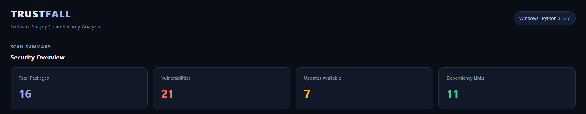

# TrustFall

**Software supply-chain security analyzer for Python environments.**

TrustFall inspects the packages installed in a Python environment, rebuilds their dependency graph, checks them against [OSV](https://osv.dev) (vulnerabilities) and PyPI (updates), and writes a JSON report plus an interactive HTML report. It can scan its own environment or an external project's virtual environment.



## Features

- **Environment + package discovery** via `importlib.metadata` (works against another project's interpreter too)
- **`requirements.txt` analysis**: missing dependencies, version mismatches, installed-but-undeclared packages
- **Dependency graph** with each package classified as `direct`, `transitive`, or `unexplained`
- **Vulnerability scan** via the OSV API, with deduplicated advisories (GHSA / CVE / PYSEC), severity and fixed versions
- **Dependency path tracing**: shows *why* a vulnerable package is installed
- **Package health**: latest PyPI version, update available, release age
- **Reports**: JSON + interactive HTML (dependency graph and package inspector)

## Tech Stack

Python 3 · `requests` · `packaging` · `jinja2` · OSV API · PyPI JSON API · vis-network (HTML report graph, loaded from a CDN)

## Installation

**Prerequisites:** Python 3, Git, and internet access (OSV and PyPI are queried live; the HTML graph loads vis-network from `unpkg.com`).

```bash
# 1. Clone
git clone https://github.com/Srijeetop/Trustfall.git
cd Trustfall

# 2. Create a virtual environment
python -m venv venv

# 3. Activate it
source venv/bin/activate          # Linux / macOS
venv\Scripts\activate             # Windows

# 4. Install the dependencies TrustFall imports
pip install requests packaging jinja2
```

> The repo's `requirements.txt` is a full `pip freeze` (UTF-16 encoded) of a large environment: Jupyter, OpenCV, scikit-learn, Windows-only packages, and more. TrustFall itself only needs the three packages above, so the command in step 4 is recommended. Use `pip install -r requirements.txt` only if you want to reproduce that exact environment.

Verify the install:

```bash
python main.py --help
```

## Usage

**Scan TrustFall's own environment**

```bash
python main.py
```

**Scan an external project** (it needs a `venv/` or `.venv/` folder in its root)

```bash
python main.py --project /path/to/your/project
```

**Use a custom interpreter** (virtual environment with another name or location)

```bash
python main.py --project /path/to/your/project --python /path/to/env/bin/python          # Linux / macOS
python main.py --project C:\path\to\project --python C:\path\to\env\Scripts\python.exe   # Windows
```

| Option | Description |
|---|---|
| `--project` | Path to the external project to scan |
| `--python` | Interpreter of the target environment (requires `--project`) |

## Output

Reports are written to the **current working directory**:

| Scan | JSON | HTML |
|---|---|---|
| Self-scan | `trustfall_report.json` | `trustfall_report.html` |
| External project | `<project>_trustfall_report.json` | `<project>_trustfall_report.html` |

Open the `.html` file in a browser. The `.json` contains the full data: `summary`, `packages`, `dependency_graph`, `vulnerability_scan` (with `dependency_paths`), `package_health`, and `manifest_analysis`.

### Interactive dependency graph

Packages are coloured by status (vulnerable, outdated, healthy, unknown); arrows point from a package to what it depends on.


### Vulnerability findings

Each finding lists the advisory IDs, severity, fixed versions, and the dependency path that pulls the package in.


## Project Structure

```
main.py                  CLI entry point, runs the whole scan
environment.py           Python environment inspection
dependency_discovery.py  Installed packages and their requirements
manifest_analyzer.py     requirements.txt vs. installed packages
dependency_graph.py      Graph building and direct/transitive/unexplained classification
dependency_paths.py      Path tracing to vulnerable packages
vulnerability_scanner.py OSV queries and advisory deduplication
package_health.py        PyPI latest-version checks
report.py                Report assembly, JSON and HTML output
templates/report.html    Jinja2 template for the HTML report
```

## Limitations

- Analyzes **installed packages** only, not source code, lock files, or `pyproject.toml`.
- External projects need a virtual environment (`venv`/`.venv` or `--python`), and that environment must have `packaging` installed.
- Manifest analysis supports only a root-level `requirements.txt` with standard PEP 508 lines (`-r`, `-e`, URLs, etc. are reported as unsupported). Without it, nothing is classified as `direct`.
- Requires network access; requests run one package at a time, so large environments are slow.
- OSV results are not checked for reachability or exploitability, and "no findings" does not mean "secure".
- Re-running overwrites the previous report; path tracing is capped at 10 paths per finding.
- Early prototype: no tests or packaging.
